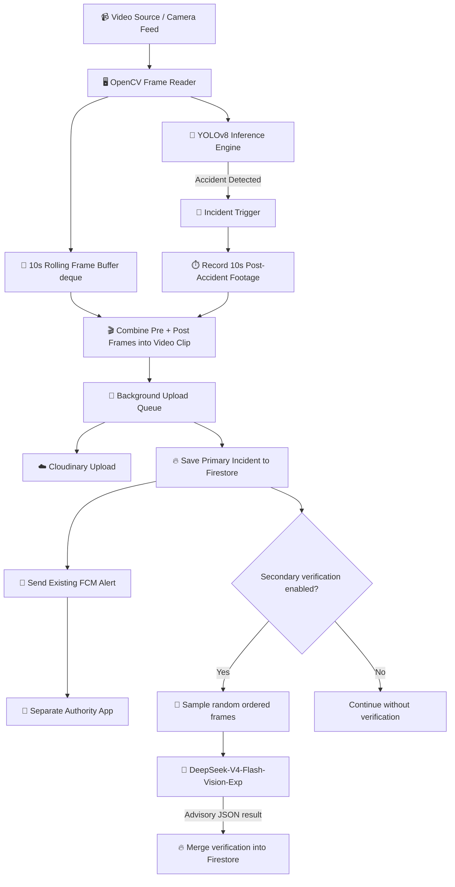

# 🚨 Crash Guard - Camera Panel

### _AI-Powered Traffic Camera Accident Detection & Alert System_

[](https://www.python.org/)
[](https://docs.ultralytics.com/)
[](https://pytorch.org/)
[](https://github.com/TomSchimansky/CustomTkinter)
[](https://firebase.google.com/)
[](https://cloudinary.com/)

---

## 📌 Project Overview

**Crash Guard** is a traffic incident detection and review project. This repository contains the Python camera panel. It processes a selected video file, detects candidate accident events, stores video evidence and incident metadata, and can send notifications through Firebase when configured.

The system consists of two primary interconnected components:

1. **Camera Panel (this repository)**: A Python desktop application built with CustomTkinter, OpenCV, and Ultralytics YOLO. The current UI selects an MP4 file for processing and asks for a camera/location name and coordinates. It is not a live-camera-stream integration or user-authentication system.
2. **Management Panel (separate component)**: The companion Flutter application is maintained separately. This repository does not contain or validate that application's authentication or production workflows. The `web/` directory contains a standalone prototype, not a production authority client.

---

## 🏗️ System Architecture & Workflow

The camera panel reads a selected video file, runs YOLO inference on sampled/resized frames, maintains a rolling pre-event frame buffer, and records post-trigger frames. The upload worker saves primary incident metadata and continues the existing FCM notification path. An optional secondary verifier queues random, chronologically ordered frames separately and asks AMD DeepSeek Vision for an advisory review. Verification is stored separately and does not gate the primary alert.



---

## ✨ Key Features

- **Video-Based Accident Detection**: Runs the configured YOLO model on sampled, resized frames from the selected MP4 and recognizes the configured accident labels (`Accident`, `mild`, `moderate`, `severe`).
- **Dynamic Pre & Post Accident Capture**: Utilizes a circular ring buffer (`collections.deque`) to store 10 seconds of pre-accident footage prior to impact and automatically captures 10 seconds post-impact for comprehensive evidence.
- **Asynchronous Cloud Pipeline**: Background workers handle video encoding, Cloudinary uploads, Firestore writes, FCM calls, and optional vision verification separately from the video processing loop.
- **Automated Cloud Storage**: Automatically renders `.mp4` video clips and uploads them to **Cloudinary** under organized project directories.
- **Incident Records and Alerts**: Writes accident records (severity, confidence, address, latitude/longitude, video URL, timestamp, and status) to **Firebase Firestore**, then sends **Firebase Cloud Messaging (FCM)** notifications to registered tokens when configured.
- **Modern Dark-Themed GUI**: Built using **CustomTkinter** for operator station/location setup, video selection, detection controls, status, and a bounding-box preview. The camera-panel form is not user authentication.
- **Detection Cooldown Engine**: Built-in anti-spam cooldown buffer to prevent duplicate alerts during continuous multi-vehicle incidents.
- **Secondary Incident Verification (Optional)**: Sends a configurable number of randomly sampled, chronologically ordered incident frames to AMD `DeepSeek-V4-Flash-Vision-Exp`. The validated result is stored under the incident's `verification` field in Firestore. It is advisory: API errors or disagreement never cancel the primary alert. Reported fire/hazard evidence is guarded against a false-positive verdict.
- **Verification Logs**: INFO logs report queued clips, sampled frame indices, request progress, verdict, confidence, recommended action, and Firestore persistence. The API key is never logged.

---

## 📁 Repository Structure

```
Crash-Guard-Camera-Panel/
│
├── app/                        # Application package
│   ├── __init__.py             # Package entry point
│   ├── config.py               # Centralized environment and config loading
│   ├── main.py                 # App bootstrap
│   ├── models/
│   │   ├── __init__.py
│   │   └── yolo_model.py       # Lazy YOLO model loading
│   ├── services/
│   │   ├── __init__.py
│   │   ├── cloudinary_service.py
│   │   ├── detection_service.py
│   │   ├── firebase_service.py
│   │   └── incident_verification_service.py
│   └── ui/
│       ├── __init__.py
│       ├── dashboard.py        # Main dashboard logic
│       └── login.py            # Login form and validation
│
├── main.py                     # Compatibility bootstrap to app.main
├── services/                   # Backwards-compatible service shims
├── models/                     # YOLO weights and legacy model compatibility module
├── tests/                      # Config, service, and verifier regression tests
├── requirements.txt            # Python dependencies
├── .env.example                # Safe environment-variable template
├── .env                        # Local secrets; ignored by Git
├── keys/                       # Local Firebase service credentials; ignored by Git
├── assets/                     # Sample videos and dataset assets
├── presentation/               # Generated project presentation assets
└── web/                        # Standalone UI prototype, not production auth
```

The application is now separated into a layered structure: configuration, model inference, service integrations, and GUI presentation. This keeps platform logic isolated from Firebase and Cloudinary operations and makes the app easier to maintain and test.

---

## 🛠️ Tech Stack & Dependencies

| Layer                      | Technology                           | Purpose                                 |
| :------------------------- | :----------------------------------- | :-------------------------------------- |
| **Language**               | Python 3.13+                         | Core programming runtime                |
| **AI / Computer Vision**   | Ultralytics YOLOv8, PyTorch          | Object detection & classification       |
| **Video Processing**       | OpenCV (`cv2`)                       | Video stream ingestion & frame encoding |
| **Desktop GUI**            | CustomTkinter, Tkinter, Pillow (PIL) | Modern dark-themed user interface       |
| **Cloud Storage**          | Cloudinary SDK                       | Hosting accident video clips (.mp4)     |
| **Database & Messaging**   | Firebase Admin SDK (Firestore & FCM) | Incident metadata & push notifications  |
| **Secondary Verification** | AMD OpenAI-compatible vision API     | Advisory visual incident review         |
| **Concurrency**            | Python `threading` & `queue`         | Multi-threaded async processing         |

---

## 🚀 Getting Started

Follow these steps to set up and run the Crash Guard Camera Panel on your local machine or monitoring node.

### 📋 Prerequisites

1.  **Python**: Python 3.10+ (Recommended: Python 3.13.6).
2.  **Git**: Installed on your system.
3.  **Firebase Account**: Access to a Firebase project with Cloud Firestore and FCM enabled.
4.  **Cloudinary Account**: API credentials for video upload.
5.  **AMD API access (optional)**: An API key and access to `DeepSeek-V4-Flash-Vision-Exp` for secondary verification.

---

### 📥 1. Clone the Repository

```bash
git clone https://github.com/AliHaider151/Crash-Guard-Camera-Panel.git
cd Crash-Guard-Camera-Panel
```

---

### 🐍 2. Create & Activate Virtual Environment

**On Windows (PowerShell):**

```powershell
python -m venv venv
.\venv\Scripts\Activate.ps1
```

**On Linux / macOS:**

```bash
python3 -m venv venv
source venv/bin/activate
```

---

### 📦 3. Install Dependencies

```bash
pip install --upgrade pip
pip install -r requirements.txt
```

---

### 🔑 4. Configure Credentials & Environment

1. **Create a local environment file** by copying the safe template:

   ```powershell
   Copy-Item .env.example .env
   ```

   On macOS/Linux, use `cp .env.example .env`.

2. **Set up Firebase**: Create a service account in Firebase Console and save its JSON key as `keys/service-account.json`. Never commit this file.

3. **Set Cloudinary credentials** in `.env` using `CLOUDINARY_CLOUD_NAME`, `CLOUDINARY_API_KEY`, and `CLOUDINARY_API_SECRET`.

4. **Set up optional AMD verification**: Add your AMD key to `AMD_API_KEY` in the local `.env`. The endpoint, model, sample count, enable flag, and timeout can also be configured there. Do not put real credentials in `.env.example`, source files, or chat. `.env` and service-account files are intended to be Git-ignored.

5. **Protect credentials**: If a real key has been placed in a shared template or committed file, treat it as exposed and rotate/revoke it in the provider console.

### Secondary Incident Verification

After primary incident metadata is saved, Crash Guard can asynchronously submit randomly sampled, chronologically ordered frames to AMD's `DeepSeek-V4-Flash-Vision-Exp` model. Verification runs independently of the existing notification path and is saved under the incident's `verification` field in Firestore. It is advisory only and never gates the primary incident alert.

Add these values to the local `.env` file to enable the AMD request. Keep the API key private and do not commit `.env`:

```env
AMD_API_KEY=your_amd_api_key
AMD_API_BASE_URL=https://developer.amd.com.cn/radeon/api/v1
INCIDENT_VERIFICATION_ENABLED=true
INCIDENT_VERIFICATION_MODEL=DeepSeek-V4-Flash-Vision-Exp
INCIDENT_VERIFICATION_FRAME_COUNT=8
INCIDENT_VERIFICATION_TIMEOUT_SECONDS=45
```

The app logs verifier progress to the terminal: selected frame indices, request start, completion verdict/confidence/action, and Firestore persistence. Missing credentials, API errors, or invalid model JSON are logged and stored as `uncertain` with `human_review`; the primary alert flow remains unchanged. Sampling is random but spread across the clip, then sorted chronologically; these non-contiguous samples do not establish continuous motion. Set `INCIDENT_VERIFICATION_ENABLED=false` to disable secondary review.

---

### 🏃 5. Run the Application

Execute the entry script:

```bash
python main.py
```

---

## 🖥️ User Guide

1.  **Station Configuration**:
    - Upon launching, enter the **Camera Address / Location Name** (e.g., `Main Boulevard Highway Cam 04`).
    - Enter the precise **Longitude** and **Latitude** of the camera placement.
    - Click **Login** to open the monitoring dashboard. This form configures a camera location; it does not authenticate an authority user.

2.  **Monitoring & Detection**:
    - Click **📂 Select Video** to choose a traffic surveillance video file (`.mp4`).
    - Click **▶ Start Detection** to process the selected video with the AI model.
    - Bounding boxes will dynamically highlight detected objects and accident severities (`Accident`, `mild`, `moderate`, `severe`).
    - The status indicator will switch from `Monitoring...` to `🚨 Accident Detected!` upon incident recognition.
    - Click **■ Stop Detection** at any time to pause monitoring.

---

Run the regression tests with:

```powershell
python -m unittest discover -s tests -p "test_*.py" -v
```

## 🎯 Model Details

- **Model Runtime**: Ultralytics YOLO. The model file is selected by `MODEL_PATH` (default: `models/best-train-2.pt`).
- **Accident Labels**: The current camera service recognizes `Accident`, `mild`, `moderate`, and `severe` as accident-trigger labels.

---

## 🔗 Related Components

- **Crash Guard Management Panel (Flutter App)**: A separate companion component. This repository contains neither its Flutter source nor a verified production authentication integration.

---

## 📄 License

This project is developed as a Final Year Project (FYP) for traffic safety research. Proprietary and academic rights reserved.
